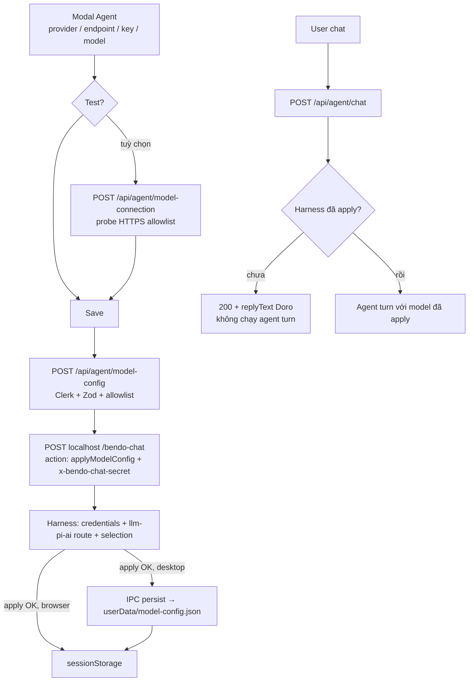

# Agent model config: Test, Save, apply, persist

Doc này mô tả chi tiết luồng user cấu hình model cho Doro: Test connection, Save (apply vào harness + persist trên máy), và re-apply khi mở app. Rule product ngắn: [`bendo-app-agent-chat.md`](./bendo-app-agent-chat.md). Không thay thế `AGENTS.md`.

---

## 1. Tổng quan luồng

| Luồng | Khi nào | Việc |
| --- | --- | --- |
| **Test** (tuỳ chọn) | User bấm Test trong modal | Next probe trực tiếp provider, **không** qua harness |
| **Save** | User bấm Save | Apply vào harness, rồi (desktop) persist `userData` |
| **Startup re-apply** | Electron: harness ready | Đọc file durable → bridge `applyModelConfig` lại |
| **Chat** | User gửi tin | Thin: `message` / `sessionId` / `clerkToken`, **không** có key/model |



Chưa apply: bridge trả **200** kèm `replyText` (soft reply của Doro), không phải lỗi 400, và không fallback sang `agent-default-model` của cordis (không có key ship).

---

## 2. Test connection và bảo mật probe

`POST /api/agent/model-connection` chạy trên Next server: chat ping (15s) + `GET …/models` tuỳ chọn (5s). Lỗi upstream map sang thông báo tiếng Việt (401 / 402 / 404 / 429 / 5xx).

| Biện pháp | Chi tiết |
| --- | --- |
| Allowlist hostname theo provider | `MODEL_API_PROVIDER_ALLOWED_HOSTS` trong `lib/agent/model-api-key.ts`; ngoài list → `ENDPOINT_NOT_ALLOWED` |
| Bắt buộc `https:` | Từ chối `http:`, userinfo, port khác 443 |
| Enforce server + client | Zod `superRefine` trên route; `isAllowedModelEndpoint` trước mọi probe; validate form |
| Không follow redirect | Mọi probe `fetch` dùng `redirect: "manual"`; status 300–399 → fail |
| Success đúng shape | OpenAI-compatible: `ok` + `choices` là array. Gemini: `ok` + `candidates` là array. 2xx sai shape → `PROVIDER_REJECTED` |
| Reset key khi đổi provider | `handleProviderChange`: luôn xoá key đang nhập; stored cùng provider → restore endpoint/model/mask; khác provider → default mới, mask = `null` |
| `joinEndpointPath` | Chỉ bỏ qua append khi `base.endsWith("/" + suffix)` (có ranh giới segment) |

| Provider | Hostname |
| --- | --- |
| OpenRouter | `openrouter.ai` |
| Vilao | `api.vilao.ai` |
| GPT | `api.openai.com` |
| Gemini | `generativelanguage.googleapis.com` |

Probe "Test connection" **khác** catalog `llm-pi-ai` dùng lúc chat: test pass vẫn có thể `UNKNOWN_MODEL` nếu route chưa được apply (mục 3).

---

## 3. Apply: dynamic route `llm-pi-ai`

Harness chỉ phục vụ model khi route có trong **`$DSH_HOME/settings.yaml`** (`llm-pi-ai.providers.<route>`). Chỉ ghi `agent-default-model` là không đủ (→ `UNKNOWN_MODEL`). Vilao không có trong builtin catalog nên phải hand-declare.

`applyModelConfig` trên chat-bridge làm theo thứ tự:

1. **Credentials:** ghi key dưới tên `apiKeyEnv` của route (seam credentials, fallback `process.env`).
2. **Settings:** `settings.mutate` set **nguyên** profile `providers.<dshRoute>` (tránh `modelOverrides` lẫn với `models`, llm-pi-ai reject). Merge `models`: giữ id đã có trên route, thêm id user vừa apply.
3. **Selection:** `agentDefaultModel.saveSelection({ provider, model })`.
4. **Gate in-memory:** set `appliedModelConfig` chỉ sau khi 1–3 thành công.

Không sửa `cordis.yml` để nhét key user.

**Map Bendo → dsh (`BENDO_PROVIDER_ROUTE` trong `bendo-agent(doro)/chat-bridge.ts`):**

| Bendo UI | dsh route | Kiểu | `api` | `apiKeyEnv` |
| --- | --- | --- | --- | --- |
| `openrouter` | `openrouter` | catalog | `openai-completions` | `OPENROUTER_API_KEY` |
| `gpt` | `openai` | catalog | `openai-completions` | `OPENAI_API_KEY` |
| `gemini` | `google` | catalog | **omit** (giữ wire native Google; model ngoài catalog bị reject lúc apply) | `GEMINI_API_KEY` |
| `vilao` | `vilao` | hand-declare (`api` + `baseURL` + `models`) | `openai-completions` | `VILAO_API_KEY` |

Ví dụ Vilao sau Save:

```yaml
llm-pi-ai:
  providers:
    vilao:
      displayName: Bendo
      apiKeyEnv: VILAO_API_KEY
      api: openai-completions
      baseURL: https://api.vilao.ai/v1
      models:
        - id: openrouter/free
          name: openrouter/free
agent-default-model:
  provider: vilao
  model: openrouter/free
```

---

## 4. Persist và startup re-apply

**Save = apply ∧ persist** (desktop). Chuỗi gọi:

1. `ModelApiKeyForm.handleSubmit` → `validateFields(true)` (`components/agent/model-api-key-dialog.tsx`)
2. `applyModelConfigViaApi` (`lib/agent/model-config-api-client.ts`) → `POST /api/agent/model-config` (`requireApiUser` + Zod + `isAllowedModelEndpoint`)
3. `getAgentRuntime().applyModelConfig` → `createDshChatAdapter().applyModelConfig` → bridge `{ action: "applyModelConfig", provider, endpoint, apiKey, model }`
4. *(desktop)* `persistDesktopModelConfig` → `persistWithRetry` → `window.bendoDesktop.saveModelConfig` → IPC `bendo:model-config:save` → `saveModelConfig` (`parseModelConfigPayload`, `encryptApiKey` qua `safeStorage`, `writeAtomic` → `userData/model-config.json`)
5. `writeStoredModelApiKey` (sessionStorage) → đóng modal

| Bước fail | Hành vi |
| --- | --- |
| Validate / apply | Dừng, **không** persist, hiện `saveError`. Không auto-retry apply |
| Persist (sau apply OK) | Retry tối đa 3 lần; vẫn fail → `saveError`, không báo "đã lưu" |
| `safeStorage` không khả dụng | `saveModelConfig` trả lỗi; không ghi key plaintext |

Non-Electron (browser / Docker): bỏ bước 4, chỉ sessionStorage.

**Hydrate modal (desktop):** mount → `loadDesktopModelConfig` → IPC `bendo:model-config:load` → decrypt → prefill + `writeStoredModelApiKey`. Fallback `readStoredModelApiKey` / default.

**Startup re-apply (Electron, không qua Next/Clerk):**

1. `ensureRuntimes` → `ensureHarnessInBackground` → `ensureHarnessServer`
2. Harness OK → `reapplyPersistedModelConfig` → `loadModelConfig` (decrypt)
3. `postApplyOnce` → `getBridgeCredentials` → bridge `applyModelConfig`
4. Retry transient (network / 5xx / timeout) tối đa 3 lần; **không** retry HTTP 400
5. Fail chỉ log, không chặn cửa sổ Bendo. Không có file / smoke → no-op

---

## 5. `DSH_HOME` trên Electron

| Trường hợp | `DSH_HOME` |
| --- | --- |
| Electron **spawn** harness | `{userData}/dsh` (mkdir trước spawn) |
| Override | `BENDO_DSH_HOME` (absolute, `~/…`, hoặc relative cwd) |
| Electron **attach** harness đang chạy ngoài | Không đổi, process đó giữ home riêng |
| `pnpm dsh web` chạy tay | `~/.dsh` trừ khi export `DSH_HOME` |

Không tự copy `~/.dsh` → `userData/dsh`; chuyển sang home do Electron quản lý thì Save lại trong Bendo. Apply ghi vào `settings.yaml` của **process harness đang phục vụ bridge**: nếu đang attach harness ngoài thì Save cập nhật home của process đó. Log spawn ghi `DSH_HOME=…`.

---

## 6. File / symbol map

| Vai trò | File | Symbol |
| --- | --- | --- |
| UI modal | `bendo-app/components/agent/model-api-key-dialog.tsx` | `handleSubmit`, `validateFields`, `handleProviderChange` |
| Defaults, allowlist, session cache | `bendo-app/lib/agent/model-api-key.ts` | `isAllowedModelEndpoint`, `joinEndpointPath`, `writeStoredModelApiKey` |
| Probe | `bendo-app/lib/agent/model-connection.ts`, `app/api/agent/model-connection/route.ts` | timeouts, redirect manual, map lỗi |
| Client apply | `bendo-app/lib/agent/model-config-api-client.ts` | `applyModelConfigViaApi` |
| Client persist | `bendo-app/lib/agent/model-config-desktop.ts` | `persistDesktopModelConfig`, `loadDesktopModelConfig` |
| API route | `bendo-app/app/api/agent/model-config/route.ts` | `POST` |
| Runtime / bridge client | `bendo-app/lib/agent/agent-runtime.ts`, `dsh-chat-adapter.ts` | `getAgentRuntime`, `applyModelConfig` |
| Harness apply + gate | `bendo-agent(doro)/chat-bridge.ts` | `BENDO_PROVIDER_ROUTE`, `buildPiAiProviderProfile`, `writePiAiProviderSettings` |
| Preload / main IPC | `desktop/src/preload/preload.ts`, `desktop/src/main/main.ts` | `bendo:model-config:save` / `load` |
| Durable store | `desktop/src/main/model-config-store.ts` | `saveModelConfig`, `loadModelConfig` |
| Startup re-apply | `desktop/src/main/apply-persisted-model-config.ts`, `runtime-manager.ts` | `reapplyPersistedModelConfig`, `postApplyOnce` |
| `DSH_HOME` | `desktop/src/main/spawn-harness.ts` | `resolveElectronDshHome`, `ensureElectronDshHome` |

---

## 7. Còn mở

- Chặn IP loopback/private **sau DNS resolution** (defense-in-depth ngoài allowlist; DNS rebinding là rủi ro còn lại).
- Nút Clear / xoá durable store từ UI (hiện đã quyết định không có nút Clear).
